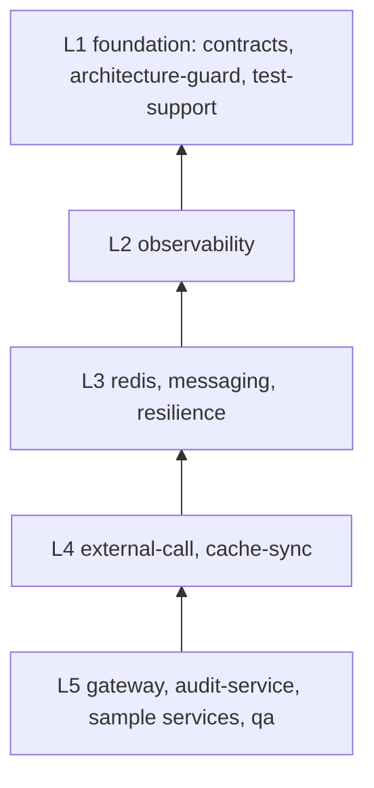

# AI Microservice Engineering Framework (AMEF)

> Build production-grade Spring Boot microservices by prompting: reusable reactive + servlet bricks, a gateway,
> QA automation, architecture guardrails and Claude Code review agents.

[](https://github.com/Williamthomas1997/ai-microservice-engineering-framework/actions/workflows/build.yml)
[](LICENSE)


**Status: under construction.** Milestone M0 (repository skeleton, versions, guards, CI) is done. The modules
below exist as empty stubs; no brick is usable yet. Progress is tracked in [`docs/reports/`](docs/reports/).
"Working name": the final project name is still to be decided.

## What this is

An open-source framework with three parts that only work well together:

1. **Bricks:** reusable Spring Boot starters (logging and tracing, Redis, Kafka, resilience, external calls, cache
   sync, contracts, architecture guard). Every brick ships a **reactive** (WebFlux) and a **servlet** (Spring MVC)
   variant over a shared core.
2. **Templates and apps:** a gateway, an audit service, reference sample services in both stacks, and a QA
   automation suite. New projects start from these.
3. **AI layer:** Claude Code skills, review agents and Python tools that add features, create bricks, compose
   services, write tests and review code, while deterministic tooling enforces the rules.

The point is to spend AI tokens on business logic only. Structure, infrastructure, tests and quality gates come
from the framework.

## Architecture

Dependencies point downwards only (`L1 → L5`), enforced by an ArchUnit test (`platform/rules`) and by
`tools/manifests.py validate`. Each infrastructure concern has exactly one owning brick. The generated module graph
is in [`docs/architecture.md`](docs/architecture.md); the plan and decisions are in
[`docs/IMPLEMENTATION_PLAN.md`](docs/IMPLEMENTATION_PLAN.md) and [`docs/adr/`](docs/adr/).



## Brick catalogue

Generated from the `brick.yaml` / `module.yaml` manifests by `python tools/manifests.py generate`. Do not edit the
table by hand.

<!-- amef:catalogue:start -->
| Layer | Module | Kind | Artifacts | Provides | Requires | Infra | Status |
|---|---|---|---|---|---|---|---|
| L1 | [`architecture-guard`](foundation/architecture-guard/) | foundation | `amef-architecture-guard` | ArchitectureRules | contracts | - | planned (M1) |
| L1 | [`contracts`](foundation/contracts/) | foundation | `amef-contracts` | ApiResponse, ErrorEnvelope, EventEnvelope, AuditEvent, CachePort, LockPort, IdempotencyPort, EventPublisher, ExternalCallPort, AuditSink, ErrorCatalog, IdGenerator, ClockPort | - | - | planned (M1) |
| L1 | [`test-support`](foundation/test-support/) | foundation | `amef-test-support` | ContainerSupport, BehaviourSuiteBase, BlockHoundSupport | contracts | - | planned (M1) |
| L2 | [`observability`](bricks/observability/) | brick | `amef-observability-core`, `amef-observability-reactive`, `amef-observability-servlet` | RequestContextFilter, MaskingEngine, Sensitive, Loggable, TracePropagation, LegacyHeaderBridge | contracts | - | planned (M2) |
| L3 | [`messaging`](bricks/messaging/) | brick | `amef-messaging-core`, `amef-messaging-reactive`, `amef-messaging-servlet` | EventPublisher, OutboxStore, AuditSink, ConsumerBase | contracts, observability | kafka, postgres | planned (M4) |
| L3 | [`redis`](bricks/redis/) | brick | `amef-redis-core`, `amef-redis-reactive`, `amef-redis-servlet` | CachePort, LockPort, IdempotencyPort, InvalidationBus, StreamQueue | contracts, observability | redis | planned (M3) |
| L3 | [`resilience`](bricks/resilience/) | brick | `amef-resilience-core`, `amef-resilience-reactive`, `amef-resilience-servlet` | ResiliencePolicies, PolicyRegistry | contracts, observability | - | planned (M4) |
| L4 | [`cache-sync`](bricks/cache-sync/) | brick | `amef-cache-sync-core`, `amef-cache-sync-reactive`, `amef-cache-sync-servlet` | SyncCache, CacheSyncAdminApi, TableSync | contracts, observability, redis, messaging | redis, postgres | planned (M6) |
| L4 | [`external-call`](bricks/external-call/) | brick | `amef-external-call-core`, `amef-external-call-reactive`, `amef-external-call-servlet` | ExternalCallPort, ClientRegistry, DefinitionRepository, PayloadCodec | contracts, observability, redis, messaging, resilience | wiremock | planned (M5) |
| L5 | [`audit-service`](apps/audit-service/) | app | `amef-audit-service` | - | contracts, observability, messaging | kafka, postgres | planned (M8) |
| L5 | [`gateway`](apps/gateway/) | app | `amef-gateway` | - | contracts, observability, redis, messaging, resilience | redis, postgres, kafka | planned (M7) |
| L5 | [`sample-service-reactive`](apps/sample-service-reactive/) | app | `amef-sample-service-reactive` | - | contracts, observability, redis, messaging, resilience, external-call, cache-sync | redis, kafka, postgres, wiremock | planned (M8) |
| L5 | [`sample-service-servlet`](apps/sample-service-servlet/) | app | `amef-sample-service-servlet` | - | contracts, observability, redis, messaging, resilience, external-call, cache-sync | redis, kafka, postgres, wiremock | planned (M8) |
| L5 | [`qa`](qa/) | qa | `amef-qa` | - | - | - | planned (M9) |
<!-- amef:catalogue:end -->

## Quick start

Not available yet: the first usable bricks arrive in M1-M3. Until then you can build the skeleton:

```bash
./mvnw clean verify                      # needs JDK 21 and a running Docker (Testcontainers)
python -m venv .venv && .venv/bin/pip install -r tools/requirements.txt   # Windows: .venv\Scripts\pip
python tools/manifests.py validate
python tools/guard/install_hooks.py      # local pre-commit / commit-msg / pre-push guards
```

## How the AI layer works

Planned for M10 (skills built from small building-block notes, review agents, `amef` CLI, evals). The early
versions of the review agents are already in [`.claude/agents/`](.claude/agents/) and run through the `/review`
command ([`.claude/commands/review.md`](.claude/commands/review.md)).

## Related project

Project memory and knowledge graphs are out of scope here. They live in a separate knowledge-engine project
(link added when it is published).

## Contributing, security, licence

See [`CONTRIBUTING.md`](CONTRIBUTING.md), [`SECURITY.md`](SECURITY.md) and [`CHANGELOG.md`](CHANGELOG.md).
Licensed under the [Apache License 2.0](LICENSE). Copyright 2026 William Thomas.
