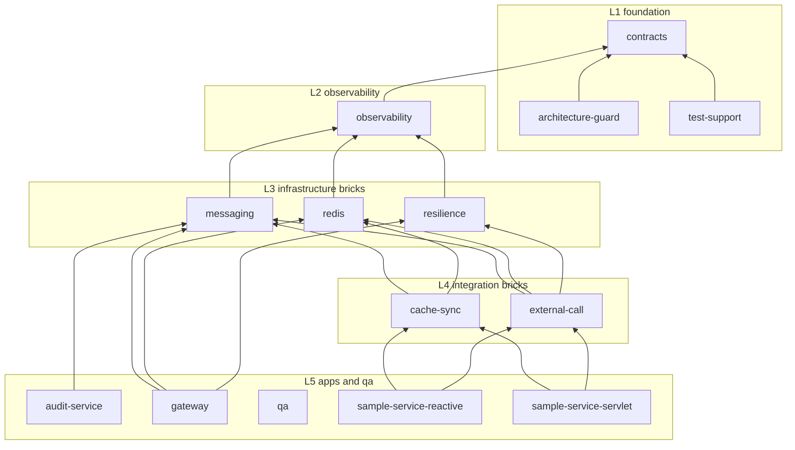

# Architecture

The rules behind this picture are in [`IMPLEMENTATION_PLAN.md`](IMPLEMENTATION_PLAN.md) and the ADRs in
[`adr/`](adr/). In short:

- Layers (spec 2.3): `L0 build` → `L1 contracts, architecture-guard, test-support` → `L2 observability` →
  `L3 redis, messaging, resilience` → `L4 external-call, cache-sync` → `L5 apps and qa`. A module may depend only on
  modules of the same or a lower layer, and never in a cycle.
- Single owner per concern (spec 2.2): exactly one brick creates each infrastructure bean.
- Every brick has `core` (stack-neutral), `reactive` (WebFlux) and `servlet` (Spring MVC) modules.

## Module dependency graph

Generated from the manifests' `requires` by `python tools/manifests.py generate` (transitive edges omitted for
readability). An arrow `A --> B` means "A requires B". Do not edit the block by hand.

<!-- amef:graph:start -->

<!-- amef:graph:end -->
